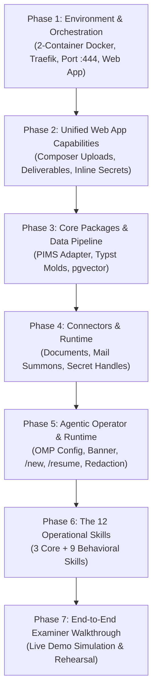

# Manual Verification & Review Checklist: UNSA PIMS Agentic Operator

> **System**: UNSA PIMS Agentic Operator (Turno B Grupo 4)  
> **Normative Framework**: ISO/IEC 27701:2025 (PII Controller Role: Admissions & Payroll Scope)  
> **Primary Source of Truth**: GESTITEL PIMS (`https://unsa.27k.pe`, tenant `unsa`, prefix `G4-`)  
> **Target Topology**: Debian Bookworm / Bun / React 19 Unified Web App / Typst / Traefik `:444` / Cloudflare  

---

## Executive Overview of the Review Plan

This manual review checklist provides a complete, step-by-step verification protocol to validate that **every implemented feature** across the entire codebase operates according to specification.



---

## Phase 1: Environment & Container Orchestration Verification

### Task 1.1: Verify Environment Configuration (`.env` & `.enc.env`)
- [ ] Inspect `.env` (or decrypt SOPS `.enc.env` via `nix run nixpkgs#sops -- decrypt .enc.env > .env`) against [.env.example](.env.example).
- [ ] Verify that all required variables are populated with valid values:
  - `PIMS_BASE_URL=https://unsa.27k.pe`
  - `PIMS_USERNAME` & `PIMS_PASSWORD` (Group 4 credentials)
  - `PIMS_TENANT_SCHEMA=unsa`
  - `PIMS_CODE_PREFIX=G4-`
  - `POSTGRES_DB`, `POSTGRES_USER`, `POSTGRES_PASSWORD`, `DATABASE_URL`
  - `EMBEDDINGS_API_KEY`, `EMBEDDINGS_BASE_URL`, `EMBEDDING_MODEL`
  - `AGENT_ENV_VAR`, `AGENT_API_KEY`, `AGENT_MODEL`
  - `SMTP_HOST=smtp.gmail.com`, `SMTP_PORT=587`, `SMTP_SECURE=false`, `SMTP_USERNAME`, `SMTP_PASSWORD`
  - `CORPUS_MIRROR_DIR=/var/lib/pimsai/corpus_mirror`
  - `DOMAIN_ROOT=pimsai.mistercricro8.top`
  - `DOCKER_HOST=tcp://docker-proxy:2375` (or host daemon)
- [ ] Confirm no placeholder string `CHANGEME` remains in `.env` and that `.enc.env` exists in repo encrypted with the configured `age` recipients.

### Task 1.2: External Docker Network Verification
- [ ] Verify or create the external proxy network:
  ```bash
  docker network inspect internal-proxy >/dev/null 2>&1 || docker network create internal-proxy
  ```
- [ ] Confirm that `internal-proxy` exists and is accessible.

### Task 1.3: Container Images Build
- [ ] Execute Docker Compose build:
  ```bash
  docker compose build
  ```
- [ ] Verify clean compilation of:
  - `pimsai-agent` (from [Dockerfile](Dockerfile): Debian Bookworm, Bun 1.2.4, Node 22 + pnpm prebuilt SPA at `/opt/pimsai-web/dist`, Chromium + `/node_modules` `@playwright/mcp` & `nodemailer`, Typst 0.15, omp 18.18.1, `age`, `poppler-utils`, `tesseract-ocr`, `/var/lib/pimsai/corpus_mirror`)
  - `pimsai-db` (`pgvector/pgvector:pg16`)

### Task 1.4: Stack Startup & Healthcheck
- [ ] Start the stack:
  ```bash
  docker compose up -d
  ```
- [ ] Verify that both containers are running and healthy:
  ```bash
  docker compose ps
  ```
  - `pimsai-db`: `healthy` (PostgreSQL 16 + pgvector listening on 5432)
  - `pimsai-agent`: `healthy` (`init: true`, Unified Web App listening on 8082, `/healthz` returning 200, background `mirror sync --loop --interval 300` logging to `/tmp/pims-mirror-sync.log`)

### Task 1.5: Reverse Proxy Edge & Port 444 Verification
- [ ] Verify Traefik `:444` public endpoint (primary) and optional Cloudflare `:443` edge rule:
  ```bash
  # Primary verified public endpoint on port 444
  curl -vk https://demo.pimsai.mistercricro8.top:444/healthz

  # Optional / Pending Cloudflare 443->444 edge rule
  curl -f https://demo.pimsai.mistercricro8.top/healthz || echo "Optional :443 edge pending"
  ```
- [ ] Verify that HTTP status 200 is returned on `:444`.

### Task 1.6: Unified Web App Session & Token Authentication
- [ ] Configure `WEB_RW_TOKEN` (and optional `WEB_RO_TOKEN`) in host `.env`.
- [ ] Access `https://demo.pimsai.mistercricro8.top:444` in a browser.
- [ ] Sign in with `WEB_RW_TOKEN` (or `WEB_RO_TOKEN` for read-only observer mode) and verify that the unified React chat interface connects to the `omp` operator cleanly.

### Task 1.7: Headless Browser / Playwright MCP Verification
- [ ] Inside `pimsai-agent`, confirm Chromium and `@playwright/mcp` resolve cleanly:
  ```bash
  docker compose exec agent which chromium node
  docker compose exec agent node /node_modules/@playwright/mcp/cli.js --version
  ```
- [ ] Verify [.mcp.json](.mcp.json) configures stdio `"playwright"` (`--headless --browser chrome --executable-path /usr/bin/chromium --no-sandbox --output-dir /tmp/playwright-mcp`) and loads in `omp`.

---

## Phase 2: Unified Web App Functional Testing (Files & Age Secrets)

### Task 2.1: Direct Composer Uploads & Deliverable Publishing (`/internal/publish`, `/api/files/*`)
- [ ] **Health Check**:
  ```bash
  curl -s http://127.0.0.1:8082/healthz
  ```
  Expected: `{"status":"ok",...}` (HTTP 200).
- [ ] **Direct Composer Attachment**:
  Attach or drag-and-drop a test document (up to 50 MB; PDF/DOC/DOCX/TXT/XLSX/PNG) directly in the web chat composer.
  Verify: File persists under `/app/data/preserved_uploads/` and the operator inspects it via `pdftotext -layout -nopgbrk` (or OCR) without auto-vectorizing or auto-uploading to PIMS.
- [ ] **50MB File Size Guard**:
  Attempt to upload a payload exceeding 50 MB (`MAX_UPLOAD_BYTES`).
  Verify: HTTP 413.
- [ ] **Deliverable Publishing (`/internal/publish`)**:
  ```bash
  PUB_RESP=$(curl -s -X POST http://127.0.0.1:8082/internal/publish \
    -H "Content-Type: application/json" \
    -d '{"slug":"manual-qa-report","filename":"report.html","content":"<h1>QA Verification Passed</h1>"}')
  echo "$PUB_RESP"
  ```
  Verify: Returns `url` pointing to `https://demo.pimsai.mistercricro8.top:444/api/files/manual-qa-report` and renders an inline **Vista previa / Descargar** card inside chat.
- [ ] **Post-Upload "Ask First" Rule**:
  Verify the operator does **not** auto-vectorize or auto-upload to PIMS upon upload completion, but rather presents the received file metadata and asks the user what to do with it.

### Task 2.2: Built-In Age Secrets Flow & Bóveda de Secretos (`/internal/secrets/*`)
- [ ] **Secret Request Generation**:
  ```bash
  SEC_RESP=$(curl -s -X POST http://127.0.0.1:8082/internal/secrets/request \
    -H "Content-Type: application/json" \
    -d '{"label":"jira_api_token","scope":"connectors"}')
  echo "$SEC_RESP"
  SEC_TOKEN=$(echo "$SEC_RESP" | jq -r '.token')
  ```
  Verify: Opens an **inline encrypted password card inside the web chat** (5-minute expiry; also manageable in **Bóveda de Secretos** drawer).
- [ ] **Secret Submission & Age Encryption**:
  Submit a test secret in the inline password card or **Bóveda de Secretos** drawer.
  Verify: Handle follows format `secret:jira_api_token@v1` and `/app/secrets/` contains `age`-encrypted ciphertext, never plaintext.
- [ ] **PostgreSQL Registry Entry**:
  Verify entry in table `secrets_registry`:
  ```sql
  SELECT * FROM secrets_registry WHERE name = 'jira_api_token';
  ```
- [ ] **Secret Polling (Immediate & Long-Poll `?wait=true`)**:
  ```bash
  curl -s "http://127.0.0.1:8082/internal/secrets/poll/$SEC_TOKEN?wait=true"
  ```
  Verify: Response returns `{"status":"submitted","handle":"secret:jira_api_token@v1",...}` with **zero** plaintext secret value.
- [ ] **Zero-Leak Guarantee**:
  Confirm that plaintext secrets never appear in terminal logs, database rows, or JSON responses.

---

## Phase 3: Core Packages & Data Pipeline Testing

### Task 3.1: PIMS Adapter Package & Companion CLI (`packages/pims-adapter`, `scripts/pims.ts`)
- [ ] **Multi-Tenant Write-Only Guard (`assertG4WriteCode`)**:
  Verify that calling `docs create`, `incidents create`, or `incidents update` with a code not starting with `G4-` (e.g. `G2-POL-001`) immediately exits non-zero with `TenantGuardViolationError` BEFORE sending an HTTP request. Also verify `docs create` and `docs add-version` reject missing `.pdf` filename / `--file-name` (`PimsValidationError`, never silently defaulting to `"version.pdf"`).
- [ ] **Uniform System-Wide Reads & Envelope Normalization**:
  Verify that `docs list`, `incidents list`, `audits list`, `risks list`, `assets list`, and `docs versions` normalize both plain JSON arrays and `{ count, results }` paginated envelopes and return full system records without `G4-` read filtering.
- [ ] **Authentication & Token Lifecycle**:
  Execute via `bun scripts/pims.ts` without printing tokens/secrets:
  ```bash
  bun scripts/pims.ts docs list --compact
  ```
  Verify: Authenticates cleanly with PIMS GESTITEL in-process using `PIMS_USERNAME` / `PIMS_PASSWORD`, zero JWT/credential leakage to stdout/stderr.
- [ ] **Live Full-System Reads (Documents, Incidents, Audits, Risks, Assets, Dashboard)**:
  ```bash
  bun scripts/pims.ts docs list --compact
  bun scripts/pims.ts incidents list --compact
  bun scripts/pims.ts audits list --dedupe --compact
  bun scripts/pims.ts risks list --compact
  bun scripts/pims.ts assets list --compact
  bun scripts/pims.ts dashboard --compact
  ```
  Verify: Structured, compact summary output across all records without `G4-` read filtering.
- [ ] **403 Probe Fallback Verification**:
  Note that `/api/trainings/` and `/api/system-catalogs/` return HTTP 403 for `grupob4` (`PimsTrainingsForbiddenError`), and that training records come from uploaded documents (`G4-CAP-INC-01` / `G4-REG-CAP-01`).

### Task 3.2: Typst Molds & XLSX Compilation (`molds/`, `corpus_g4_src/`)
- [ ] **Full Render Test (`scripts/render-all.ts`)**:
  Run:
  ```bash
  bun scripts/render-all.ts
  ```
  Verify:
  - Exit code is 0.
  - All 54 Typst version callers (`corpus_g4_src/**/*.typ`) compile to PDF without syntax or font errors.
  - All 9 normative XLSX spreadsheets are generated:
    - Incident Register (ISO 27701 B.3.12): `G4-REG-INC-01` (v1, v2, v3)
    - Risk Assessment (Apéndice 1): `G4-RSK-INC-01` (v1, v2, v3)
    - Risk Treatment Plan (Apéndice 2): `G4-PLN-RSK-01` (v1, v2, v3)
  - 18 manifest files (`corpus_mirror/<code_id>/manifest.json`) are updated with matching SHA-256 digests.
- [ ] **Decoupled Architecture Verification**:
  - Confirm that `molds/**/mold.typ` are pure, stateless parameterized functions with **zero** hardcoded instance data.
  - Confirm that version callers in `corpus_g4_src/` pass data dictionaries via `#let data = (...)`.
  - Confirm that `molds/` is never modified in-place during normal operation.

### Task 3.3: pgvector Mirror & RAG Engine (`packages/rag-mirror`)
- [ ] **Run Unit & Smoke Tests**:
  ```bash
  bun packages/rag-mirror/fixtures/smoke.ts
  ```
  Verify all 6 tests pass:
  1. Ingest v1
  2. Ingest v2 (supersedes v1)
  3. Query with cosine search & metadata filter
  4. Structural version comparison (diff v1 vs v2)
  5. Missing version typed error handling
  6. Re-vectorization from local corpus mirror
- [ ] **Test RAG Query CLI (`scripts/rag-query.ts`)**:
  Execute against local pgvector database:
  ```bash
  bun scripts/rag-query.ts "procedimiento de respuesta ante incidentes" --limit 3
  ```
  Verify:
  - Returns verbatim quotes from active/non-obsolete `chunks` by default (pass `--include-obsolete` to include historical `O` versions).
  - Citation follows exact canonical format: `pims:<doc.code>:v<version>:<chunk_id>:<lines>` (e.g., `pims:G4-SOA-01:v4.00:5:L114-L133`).
  - Check distance metric is cosine distance (`<=>`).
- [ ] **Test Full-Document Read & Extracted PDF Diff (`scripts/pims.ts mirror read`, `scripts/pims.ts diff`)**:
  ```bash
  bun scripts/pims.ts mirror read G4-PRC-INC-01 | head -n 40
  bun scripts/pims.ts diff G4-PRC-INC-01 --from 1.00 --to 3.00
  ```
  Verify: `mirror read` (delegating to canonical `scripts/rag-query.ts --full`) dumps clean normalized UTF-8 text from `CORPUS_MIRROR_DIR/<doc.code>/v<n>.txt` (extracted with `pdftotext -layout -nopgbrk`, or OCR via `tesseract` for scanned PDFs), and `diff` diffs extracted PDF text cleanly via `pdftotext` (never `%PDF-` binary bytes).

### Task 3.4: PIMS Truth Synchronization (`scripts/pims.ts mirror sync`, `scripts/sync-pims-truth.ts`)
- [ ] **One-Shot Sync Pass (`doc.code` Keying)**:
  ```bash
  bun scripts/pims.ts mirror sync
  # (Delegates directly to canonical scripts/sync-pims-truth.ts)
  bun scripts/sync-pims-truth.ts
  ```
  Verify:
  - Connects to `https://unsa.27k.pe` and fetches all PIMS documents.
  - Keys `CORPUS_MIRROR_DIR/<doc.code>/` and `pimsai-db` (`pims_registry`, `chunks`) strictly by **`doc.code`** (e.g. `G4-POL-01`), never numeric DB IDs.
  - Writes sibling extracted `v<n>.txt` alongside every `.pdf`.
  - Prunes any stale numeric-ID rows/folders and mismatched seed versions.
- [ ] **Loop Mode Check (Compose Hook)**:
  Verify `bun scripts/pims.ts mirror sync --loop --interval 300` (or `bun scripts/sync-pims-truth.ts --loop --interval 300` invoked as background sync hook in compose) starts the background daemon and reports `[sync-loop]` log entries every 5 minutes.

### Task 3.5: PIMS Upload Tool (`scripts/upload-pims-truth.ts`)
- [ ] **Dry-Run Validation**:
  ```bash
  bun scripts/upload-pims-truth.ts
  ```
  Verify:
  - Runs in dry-run mode by default (zero network mutations).
  - Validates all 18 documents.
  - Plans 72 POST operations (18 creates, 36 version additions, 18 approvals).
  - Exits with status 0.
- [ ] **Live Upload Evidence Inspection**:
  Verify [docs/PIMS-UPLOAD-EVIDENCE.md](docs/PIMS-UPLOAD-EVIDENCE.md) confirms all 54 versions reside on `unsa.27k.pe` with IDs 1 to 18.

---

## Phase 4: Connectors Framework & Runtime Testing

### Task 4.1: Connector Runtime & Secret Handles (`connectors/runtime/`)
- [ ] **Handle Format Parsing**:
  Verify `parseSecretHandle("secret:db_token@v2")` returns `{ name: "db_token", version: 2 }`.
  Verify invalid formats (e.g. `secret:foo`, `plain-token`) throw `SecretHandleFormatError`.
- [ ] **Docker Env Var Resolution**:
  Verify `resolveToDockerEnv("API_KEY", "secret:test@v1")` outputs `["--env", "API_KEY=..."]` without printing the value.
- [ ] **Dynamic Skill Registration (`registerConnector`)**:
  Test registration of template connector:
  ```typescript
  import { registerConnector } from "./connectors/runtime/register.ts";
  await registerConnector({
    connectorDir: "connectors/mail",
    skillPath: ".omp/skills/connectors/SKILL.md",
  });
  ```
  Verify: Idempotently wraps and inserts `<!-- CONNECTOR: mail START -->` into `.omp/skills/connectors/SKILL.md`.

### Task 4.2: Mail Connector & Real Gmail SMTP Dispatch (`connectors/mail/`)
- [ ] **Persisted Draft Summons Creation**:
  Create draft summons across citations (`pims:`, `audit:`, `incident:`, or `"Sin evidencia"`):
  ```typescript
  import { MailConnectorClient } from "./connectors/mail/client.ts";
  const mailClient = new MailConnectorClient({ fromAddress: process.env.SMTP_USERNAME! });
  const draft = await mailClient.createDraftSummons({
    findingId: "AUD-2026-003-F01",
    nonConformityTitle: "Falta de MFA en portal de admisión",
    severity: "red",
    recipientName: "Responsable SGPI",
    recipientEmail: "dpo@unsa.edu.pe",
    deadlineDate: "2026-11-30",
    evidenceCitation: "pims:G4-PRC-INC-01:v3.00:1:L1-L24",
    correctiveActionSummary: "Implementar autenticación de doble factor en portal de admisión",
  });
  ```
  Verify: Draft survives in a fresh `bun` process via `mailClient.getDraft(draft.draftId)` (`MAIL_DRAFTS_PATH`).
- [ ] **Strict Dispatch Gate ("envíalo") + Real Gmail SMTP (`nodemailer`)**:
  - Confirm calling `dispatchSummons(draft.draftId, "ok")` throws `SummonsApprovalRequiredError` (`SUMMONS_APPROVAL_REQUIRED`).
  - Confirm `SMTP_USERNAME` + `SMTP_PASSWORD` resolve cleanly via `nodemailer` (`smtp.gmail.com:587`) and real Gmail SMTP delivery requires `"envíalo"`.

---

## Phase 5: Agentic Operator Interface & Extension Controls (`.omp/`)

### Task 5.1: Startup Banner & Branding
- [ ] Open the unified web app (`https://demo.pimsai.mistercricro8.top:444`) or an interactive `omp` session:
  ```bash
  omp
  ```
- [ ] Verify that the first visible message is the standardized intro banner from [.omp/extensions/intro.ts](.omp/extensions/intro.ts):
  ```
  UNSA PIMS — OPERADOR AGÉNTICO DEL SGPI (GRUPO 4)
  ISO/IEC 27701:2025 — Universidad Nacional de San Agustín
  ...
  Comandos iniciales útiles:
  • /new              Iniciar una nueva conversación limpia
  • /resume           Retomar una sesión anterior
  • mas ayuda         Mostrar la guía operativa completa
  ```

### Task 5.2: Interactive Command `mas ayuda`
- [ ] In chat prompt, send: `mas ayuda`.
- [ ] Verify: Operator intercepts input and outputs the complete operational manual from [.omp/USAGE.md](.omp/USAGE.md) without consuming model LLM generation tokens.

### Task 5.3: Session Reset (`/new`) & Session History (`/resume`)
- [ ] Send `/new`.
- [ ] Verify: The active chat session resets immediately, clearing working context while preserving agent configuration. The banner re-appears cleanly.
- [ ] Send `/resume`.
- [ ] Verify: The session history picker opens, allowing selection of prior inspection threads.

### Task 5.4: Transcript Credential Redaction Filter
- [ ] Simulate or send a message containing a JWT token (`eyJ...`), Bearer token, or password assignment.
- [ ] Inspect session transcript in `.omp/` logs.
- [ ] Verify: Redaction replaces raw values with `[REDACTED_JWT_TOKEN]`, `[REDACTED_TOKEN]`, or `[REDACTED_SECRET]`.

### Task 5.5: Token Budget & Degraded-at-Cap Policy
- [ ] Inspect [.omp/config.yml](.omp/config.yml):
  - Confirm `task.softRequestBudget: 150`.
  - Confirm `task.softRequestBudgetNotice: true`.
- [ ] Verify degraded-at-cap behavior:
  - If budget cap is crossed, document retrieval and query remain active.
  - Generative modifications pause with mandatory loan profile message directing the user to the loan coordinator.

---

## Phase 6: The 12 Operational Skills Verification (Behavior Matrix)

Verify all 12 `.omp/skills/*/SKILL.md` skills carry valid YAML frontmatter (`name` + `description`), then test each skill:

### Skill 1: `pims-reader`
- [ ] **Prompt**: `"Consulta el documento G4-POL-01 en PIMS y muestra su estado actual y versiones."`
- [ ] **Expected Output**:
  - Connects to GESTITEL API via `bun scripts/pims.ts docs get G4-POL-01` and `bun scripts/pims.ts docs versions G4-POL-01` without reading `.env` or printing JWTs.
  - Reads full PIMS system uniformly (`G4-` enforced only on writes).
  - Returns ID, version (`"3.00"`), status (`R` or `V`), and version history table.
- [ ] **Failure Fallback Probe**:
  - Simulate network disconnection (`PIMS_BASE_URL` unreachable).
  - Verify: Reports exact endpoint + HTTP error, answers immediately from `CORPUS_MIRROR_DIR` + `pimsai-db`, and prefixes with `[FUENTE: Cache local pgvector mirror (PIMS no disponible)]`.

### Skill 2: `doc-necessity`
- [ ] **Prompt**: `"¿Cuáles documentos del SGPI son obligatorios y cuáles son opcionales según ISO/IEC 27701:2025?"`
- [ ] **Expected Output**:
  - Evaluates against clean [reference/iso-27701-2025.md](reference/iso-27701-2025.md) (NOT `docs/ISO-27701-NORMATIVE-MAP.md`) + live PIMS state + `university-facts/`/`G4-ALC-01`/`G4-SOA-01`.
  - Applies 3-tier classification (Unconditional `shall` / Context-/Risk-/Scope-dependent / Discretionary Optional) and PII Controller scope (Tables A.1 & A.3 in scope; A.2 excluded with justification).
  - Also test general normative question (`"¿La ISO 27701 exige un procedimiento de gestión de incidentes?"`) and verify direct normative citation from `reference/iso-27701-2025.md`.

### Skill 3: `version-compare`
- [ ] **Prompt**: `"Compara la versión 1 y la versión 3 de la política de privacidad G4-POL-01 y explica el racional del cambio."` (Also test a multi-version evolution query: `"Resume la evolución completa de G4-ALC-01 desde v1 hasta v3."`)
- [ ] **Expected Output**:
  - Diffs **live PIMS PDFs** via extracted text (`pdftotext -layout`, `bun scripts/pims.ts diff G4-POL-01 --from 1.00 --to 3.00`, or `v<n>.txt`) without relying on `corpus_g4_src/`.
  - Extracts `change_summary` and PDF revision history table; uses internal template rationale **silently (never mentions `RAFA.md` or `RAFA`)** and flags expired `validity` dates if applicable.
  - Publishes via `bun scripts/pims.ts publish` with a **real shell UTC timestamp slug** (`version-compare-...-$(date -u +%Y%m%d-%H%M)`) for BOTH two-version diffs and multi-version evolution queries, returning `https://demo.pimsai.mistercricro8.top:444/api/files/<slug>` (inline **Vista previa / Descargar** card).

### Skill 4: `incident-ops`
- [ ] **Prompt**: `"Muestra el tablero semafórico de acciones correctivas de incidentes."`
- [ ] **Expected Output**:
  - Reads **all** system incidents (`INC-001`..`INC-012`) and audits (`AUD-2026-001`..`003`) uniformly; deduplicates cloned rows on `AUD-2026-003` and reports separate **`Findings`** vs **`Actions`** counts (`incidents get --json` uses `--with-history` when full history is needed).
  - Strict green verification: `🟢 VERDE` ONLY when `status === "C"`, `progress === 100`, `closed_at !== null`, and verifiable evidence exists (e.g., `INC-001` remains 🟡/🔴 while `AUD-2026-002` CAPA is open or evidence is missing).
  - Proactively offers to prepare summons in executive Spanish (no internal skill/CLI leaks).
  - Publishes deliverable via `https://demo.pimsai.mistercricro8.top:444/api/files/<slug>` using real UTC timestamp slug.
- [ ] **Two-Turn Incident Write Check**:
  - Prompt to register or update a `G4-INC-...` incident -> Turn 1 runs `--dry-run`, prints full payload (including `--incident-type`, `--involves-personal-data`, and `G4-` title/code), and **HALTS**; Turn 2 passes `--confirm` ONLY after explicit user confirmation naming the incident.

### Skill 5: `summons-dispatch`
- [ ] **Prompt**: `"Prepara las citaciones para los responsables con acciones en rojo y ámbar."`
- [ ] **Expected Output (Phase A)**:
  - Resolves real recipient emails (`dpo_contact_email`, `rep_email`, or asks user when missing on audit records).
  - Persists drafts on disk via `MailConnectorClient` (`connectors/mail/client.ts`); sends ZERO emails.
  - Displays the **full verbatim email subject + body** before halting on `"envíalo"`.
- [ ] **Prompt**: `"envíalo"`
- [ ] **Expected Output (Phase B)**:
  - Dispatches real email via Gmail SMTP (`nodemailer`) using `SMTP_*` env without printing credentials.
  - Ends with `resultado aquí: https://demo.pimsai.mistercricro8.top:444/api/files/<slug>` if report generated.

### Skill 6: `audit-chain`
- [ ] **Prompt**: `"Rastrea la cadena de auditoría del hallazgo o incidente pendiente y muestra su evidencia exacta en PIMS."`
- [ ] **Expected Output**:
  - Reads audits & incidents uniformly (no `G4-` read gate); reports separate `Findings` vs `Actions` counts when using `--dedupe`.
  - Maintains strict consistent traffic lights (`INC-001` = 🟡/🔴 while `AUD-2026-002` CAPA is open or evidence is missing).
  - Traces Finding/Incident → NC → Corrective Action → Owner/Deadline → verbatim RAG chunk citation `pims:<doc.code>:v<version>:<chunk_id>:<lines>` (`--full` when needed).
  - Publishes via unified web app at `https://demo.pimsai.mistercricro8.top:444/api/files/<slug>` using real UTC timestamp slug (`$(date -u +%Y%m%d-%H%M)`).

### Skill 7: `directed-version`
- [ ] **Prompt (Existing `G4-` Document)**: `"Actualiza el procedimiento de incidentes G4-PRC-INC-01 para formalizar el canal de reporte en la filial Camaná."`
- [ ] **Expected Output**:
  - Enforces `G4-` write prefix.
  - Inspects live PIMS `/versions/` (via `bun scripts/pims.ts docs versions G4-PRC-INC-01`), aligns PDF cover/footer/history with next PIMS integer (`"4.0"` matching PIMS `"4.00"`), and notes minor vs. major in `change_summary`.
  - Executes copy-then-fill staging (`/tmp/pims-staging/...`) copying `molds/common/` and `molds/<category>/mold*.typ`, extracting current data via `pdftotext -layout` / `CORPUS_MIRROR_DIR` `v<n>.txt` (or OCR if scanned, without `corpus_g4_src/`), reading `RAFA.md` **silently**, escaping `@` as `\@` inside `[...]`, populating `reviewer` from `university-facts/organigrama.md`, and verifying zero internal terms (`Typst`, `Bun`, `RAFA`, `molds/`) in compiled PDF.
  - Compiles PDF via Typst, publishes preview via `bun scripts/pims.ts publish`, and **HALTS for explicit nominal human approval** before calling `bun scripts/pims.ts docs add-version ... --confirm` (with explicit `.pdf` `fileName`) or syncing `pgvector`.
- [ ] **Prompt (Cross-Team / Arbitrary Non-Typst PDF Adaptation)**: `"Toma el documento G2-POL-01 (o un PDF externo subido) y genera una versión actualizada para Grupo 4."`
- [ ] **Expected Output**:
  - Extracts 100% of source PDF content via `pdftotext -layout` (or `pdftoppm -png` + `tesseract` OCR for scanned PDFs) without assuming source PDF used Typst.
  - Maps to matching `molds/<category>/mold*.typ` or universal `molds/generic/mold.typ`.
  - Assigns a traceable `G4-` target code (`docs add-version` on `G4-` counterpart or `docs create --code G4-...`), records `"Basado en <source> v<n>"` in Revision History & References, explains shared-tenant `G4-` isolation clearly in Spanish, publishes preview, and **HALTS at Gate 2** before any PIMS write.

### Skill 8: `cascade`
- [ ] **Prompt**: `"La UNSA aprobó la Resolución Rectoral N° 0215-2026 formalizando la Filial Mollendo. Aplica el cambio en cascada sobre los documentos del PIMS."`
- [ ] **Expected Output (Phase A)**:
  - Checks `university-facts/facts.json` first (skips redundant `university-facts/<slug>.json` if fact is already incorporated; records new file only for genuinely new facts).
  - Scans all documents uniformly across PIMS + `CORPUS_MIRROR_DIR` (`--full` + RAG query), explicitly including **`G4-RSK-INC-01`** alongside **`G4-PLN-RSK-01`** when new physical sites/assets enter scope.
  - Presents proposed remake batch (with aligned next PIMS integer versions) vs unaffected documents and halts at Gate 1 (`"procede"`).
- [ ] **Prompt**: `"aprobado, procede con la cascada"`
- [ ] **Expected Output (Phase B — compile+preview, then STOPS)**:
  - Compiles approved documents via copy-then-fill staging (checking `\@`, `reviewer`, zero internal terms), publishes previews via `bun scripts/pims.ts publish`, and **HALTS at Gate 2** (preview gate is SEPARATE from upload gate).
- [ ] **Prompt**: `"confirmo subida de <doc> v<ver>"` (names doc+version explicitly)
- [ ] **Expected Output (Phase C — upload)**:
  - Uploads new versions with `change_summary` via `bun scripts/pims.ts docs add-version ... --confirm`, runs `bun scripts/pims.ts mirror sync` (or canonical `sync-pims-truth.ts`), and publishes report at `https://demo.pimsai.mistercricro8.top:444/api/files/<slug>`.

### Skill 9: `live-build`
- [ ] **Prompt**: `"Despliega un servicio interactivo o portal de alertas en vivo (con su base de datos si la requiere) e intégralo con los incidentes del SGPI."`
- [ ] **Expected Output**:
  - Interactive session: confirms target immediately and dispatches background subagent (`task`) while main chat remains responsive to PIMS queries (`omp -p` non-interactive mode runs inline).
  - Performs **preflight image inspection** (`docker image inspect`, `docker run --rm --entrypoint sh <image> -c '...'`) before launching via `docker-proxy:2375`.
  - If the service needs a database or cache, spawns an **isolated per-stack companion DB** (`pimsai-<slug>-db` on `<slug>-net` with named volume `<slug>-db-data`, never sharing `pimsai-db`).
  - Exposes any **native web admin/setup UI directly on Traefik `:444`** (`internal-proxy`, full TLS labels, never claiming `demo`), handing the user the verified `:444` URL, generated setup/admin access code, and concise browser steps (building custom Bun HTTP server ONLY if no native UI exists).
  - Enforces **copy-never-bind** (no `-v /app/...`), runs **fast 5–10s boot diagnostics** (`docker inspect` + `docker logs --tail 30`), verifies internal `healthCheck()` + public `:444` `curl`, registers via `registerConnector({ connectorDir: "connectors/<name>" })`, reads PIMS incidents uniformly (including `incidents get <CODE> --json`), and uses generated random keys for self-hosted services vs `secrets_request` (inline encrypted password card + `async: true` `?wait=true` poll) for external user credentials.

### Skill 10: `ingest`
- [ ] **Prompt**: `"Sincroniza y re-ingesta el documento G4-SOA-01 en la base de datos vectorial."`
- [ ] **Expected Output**:
  - Downloads PDF from PIMS, saves under `CORPUS_MIRROR_DIR/G4-SOA-01/` (`v<n>.pdf` + `v<n>.txt` extracted via `pdftotext -layout -nopgbrk`, or `pdftoppm` + `tesseract` OCR for scanned PDFs + `manifest.json`) keyed strictly by `doc.code`.
  - Computes per-chunk SHA-256 digests + 1024-dim `mistral-embed` vectors and upserts `pims_registry` + `chunks`.
  - `rag-query.ts` defaults to active/non-obsolete versions (`--include-obsolete` opt-in) and cites `pims:<doc.code>:v<version>:<chunk_id>:<lines>`.

### Skill 11: `connector-builder`
- [ ] **Prompt**: Simulate a connector schema breakage or test connector scaffolding.
- [ ] **Expected Output**:
  - Reports exact failure signature.
  - Executes read-only probes first.
  - Patches `client.ts` and updates `SKILL-FRAG.md` + `registerConnector()`.
  - Answers from pgvector mirror throughout the repair.

### Skill 12: `proactive`
- [ ] **Prompt**: Ask any standard operational question (e.g. `"¿Cuál es el alcance actual del SGPI?"`).
- [ ] **Expected Output**:
  - Answers the direct question accurately in executive Spanish (no internal paths, skill names, or CLI flags).
  - Proactively offers ≤2 contextually adjacent verified items (*"¿Deseas examinar también la Declaración de Aplicabilidad (SoA) que deriva de este alcance?"*).
  - Routes unanticipated integration requests gracefully to `live-build`.

---

## Phase 7: End-to-End Examiner Walkthrough (Rehearsal Simulation)

Conduct this unbroken sequence simulating the course instructor's live evaluation:

```
[Step 1: Welcome & Setup]
  1. Access the Unified Web App via WEB_RW_TOKEN at https://demo.pimsai.mistercricro8.top:444.
  2. Confirm session banner displays clean identity and commands.
  3. Send: mas ayuda -> Confirm clean Spanish user guide prints (zero internal leaks).
  4. Send: /new -> Confirm session resets cleanly.

[Step 2: Normative & State Queries]
  5. Ask: "¿Cuál es el rol de la UNSA bajo ISO/IEC 27701:2025 y qué tablas del Anexo A aplican?"
     -> Verify: PII Controller, Tables A.1 and A.3 in scope, Table A.2 excluded with justification in SoA.
  6. Ask: "¿Cuáles documentos de nuestro alcance son obligatorios según la norma?"
     -> Verify: doc-necessity shall-test execution against live PIMS state.

[Step 3: Incidents & Traffic Light Governance]
  7. Ask: "Muestra el estado de incidentes y no conformidades."
     -> Verify: incident-ops Red/Amber/Green table across all system incidents/audits with separate deduplicated Findings vs Actions counts and strict green check.
  8. Ask: "Prepara las citaciones para los responsables en rojo."
     -> Verify: summons-dispatch persisted draft showing full verbatim subject + body using real PIMS emails; pauses at human gate.
  9. Send: envíalo
     -> Verify: real Gmail SMTP dispatch executed and delivery log published at `https://demo.pimsai.mistercricro8.top:444/api/files/<slug>`.

[Step 4: Evidence & Version Control]
  10. Ask: "Explica el hallazgo o incidente pendiente y muestra su evidencia auditable."
      -> Verify: audit-chain trace with strict traffic light, verbatim quote, and canonical pims:<doc.code>:v<version>:<chunk_id>:<lines> citation.
  11. Ask: "¿Qué cambió entre la v1 y v3 del procedimiento de incidentes G4-PRC-INC-01?"
      -> Verify: version-compare extracted-text structural diff, history rationale (no internal leaks), and published `/api/files/<slug>` report with UTC timestamp.

[Step 5: Live Mutation & Dynamic Build]
  12. Ask: "¿Cómo te subo un archivo de auditoría externo?"
      -> Verify: directs user to attach/drag-and-drop directly in the chat composer (up to 50 MB); "Ask First" inspection upon attachment arrival.
  13. Ask: "Despliega un servicio de alertas o panel interactivo en vivo y conéctalo a los incidentes."
      -> Verify: live-build background dispatch; preflight image inspection; isolated companion DB if needed; native UI exposed on :444 with access code & browser steps; uninterrupted main chat.
```

---

## Final Verification Sign-Off Table

| Subsystem / Feature Area | Verification Status | Tested By | Date | Notes |
|---|---|---|---|---|
| **1. Docker & VPS Orchestration (2-Container)** | ⬜ PASS / ⬜ FAIL | | | |
| **2. Unified Web App (Uploads, Deliverables, Secrets)** | ⬜ PASS / ⬜ FAIL | | | |
| **3. PIMS Adapter & Tenant Isolation** | ⬜ PASS / ⬜ FAIL | | | |
| **4. Typst Molds & XLSX Compilers** | ⬜ PASS / ⬜ FAIL | | | |
| **5. pgvector RAG Mirror & Citations** | ⬜ PASS / ⬜ FAIL | | | |
| **6. Connectors Framework & Mail Gate** | ⬜ PASS / ⬜ FAIL | | | |
| **7. OMP Interface & Extension Tools** | ⬜ PASS / ⬜ FAIL | | | |
| **8. The 12 Operational Skills** | ⬜ PASS / ⬜ FAIL | | | |
| **9. Live Examiner Simulation Walkthrough** | ⬜ PASS / ⬜ FAIL | | | |
