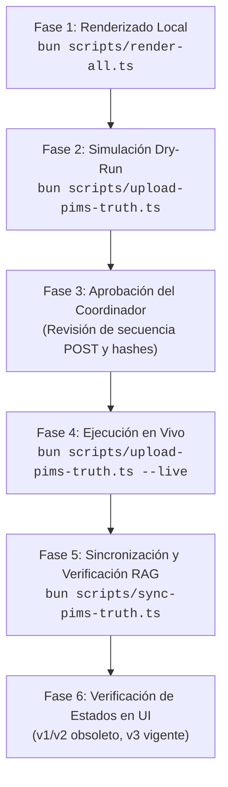

# Runbook Operativo de Carga Documental a GESTITEL PIMS
## Sistema de Gestión de Privacidad de la Información (SGPI) — UNSA Grupo 4

> **Entorno Oficial**: `https://unsa.27k.pe`  
> **Esquema de Inquilino (Tenant)**: `unsa`  
> **Aislamiento Multi-inquilino**: Prefijo obligatorio `G4-` (prohibición terminante de mutar o consultar registros de otros grupos).  
> **Axioma de Verdad**: Los archivos locales `.typ`, `.ts` y `corpus_mirror/` son moldes y artefactos temporales; el registro vinculante de auditoría de certificación reside exclusivamente en GESTITEL PIMS.

---

## 1. Propósito y Requisitos Previos

Este documento establece la secuencia operativa obligatoria para renderizar, verificar, aprobar y cargar los 18 documentos del SGPI de la UNSA a la plataforma institucional GESTITEL PIMS mediante la Documents API (`packages/pims-adapter/documents.ts`).

### Requisitos Técnicos del Entorno
- **Runtime**: Bun 1.1+ (ejecutable vía Nix o entorno local: `bun`). Prohibido terminantemente el uso de npm.
- **Motor de Renderizado**: Typst 0.15+ (`typst` en PATH o `nix run nixpkgs#typst`).
- **Fuentes Tipográficas**: Familia `Liberation Sans` instalada en el sistema.
- **Variables de Entorno para Ejecución en Vivo (`.env`)**:
  ```bash
  PIMS_BASE_URL=https://unsa.27k.pe
  PIMS_SCHEMA=unsa
  PIMS_USERNAME=<usuario_asignado_grupob4>
  PIMS_PASSWORD=<credencial_segura_pims>
  ```
  *(Nota de seguridad: Las credenciales jamás deben imprimirse ni registrarse en logs de consola).*

---

## 2. Secuencia Operativa Exacta (6 Fases)



### Fase 1: Renderizado Local de Artefactos
1. Ejecutar el script compilador integral desde la raíz del repositorio:
   ```bash
   bun scripts/render-all.ts
   ```
2. **Criterios de Éxito de Fase 1**:
   - Salida con código `0`.
   - 34 archivos PDF compilados en `corpus_mirror/<code>/v<n>.pdf`.
   - 7 libros XLSX generados:
     - `corpus_mirror/G4-REG-INC-01/v1.xlsx`, `v2.xlsx`, `v3.xlsx` (Registro B.3.12).
     - `corpus_mirror/G4-RSK-INC-01/v1.xlsx`, `v2.xlsx`, `v3.xlsx` (Evaluación Apéndice 1).
     - `corpus_mirror/G4-PLN-RSK-01/v3.xlsx` (Tratamiento Apéndice 2).
   - 18 archivos `manifest.json` emitidos con sumas SHA-256 calculadas.
   - Si Typst reporta algún error de sintaxis en un molde, el proceso se interrumpe de inmediato mostrando archivo y línea exacta.

### Fase 2: Inspección y Revisión en Modo Simulación (Dry-Run)
1. Ejecutar el planificador de carga (por defecto corre en modo seguro `DRY-RUN`):
   ```bash
   bun scripts/upload-pims-truth.ts
   ```
2. **Criterios de Éxito de Fase 2**:
   - Salida con código `0`.
   - Cero peticiones de red emitidas hacia `https://unsa.27k.pe`.
   - Impresión completa de la secuencia de 52 acciones POST planificadas para los 18 documentos.
   - Verificación de campos FormData: códigos con prefijo `G4-`, categorías de longitud ≤50 caracteres, responsable institucional asignado (`Ing. Carlos M. Benítez`), y resúmenes de cambio (`change_summary`) estructurados conforme al formato de tres partes de `molds/README.md`.

### Fase 3: Aprobación Formal del Coordinador
1. El despachador u operador debe remitir el resumen del dry-run al coordinador de la orden de trabajo (`term_a379b037-40b0-4222-aafd-9a0e55170bf9`).
2. Validar que no existan colisiones de código ni inconsistencias en las fechas de versión (`2019-04-15` para v1.0, `2022-09-10` para v2.0, `2025-10-28` para v3.0).
3. **Alto obligatorio**: No proceder a la Fase 4 sin el visto bueno expreso del coordinador.

### Fase 4: Ejecución en Vivo de la Carga a PIMS
1. Tras obtener la aprobación formal, ejecutar con la bandera obligatoria `--live`:
   ```bash
   bun scripts/upload-pims-truth.ts --live
   ```
2. **Comportamiento Operativo**:
   - Para documentos multiversión (`v1.0`, `v2.0`, `v3.0`):
     - `POST /api/documents/`: Crea el documento con el PDF de la versión v1.0 en estado inicial `obsoleto` (`O`).
     - `POST /api/documents/{id}/versions/`: Adjunta el PDF v2.0 con su respectivo `change_summary`.
     - `POST /api/documents/{id}/versions/`: Adjunta el PDF v3.0 con su respectivo `change_summary`.
     - `POST /api/documents/{id}/approve/`: Aprueba el documento, fijando la versión v3.0 en estado `vigente` (`V`).
   - Para documentos de versión única consolidada (`v3.0`):
     - `POST /api/documents/`: Crea el documento con el archivo v3.0 en estado `vigente` (`V`).
     - `POST /api/documents/{id}/approve/`: Formaliza la aprobación rectoral en PIMS.

### Fase 5: Sincronización y Verificación RAG
1. Ejecutar el script de sincronización de la base de verdad:
   ```bash
   bun scripts/sync-pims-truth.ts
   ```
2. **Criterios de Éxito de Fase 5**:
   - Recuperación de los 18 documentos desde la API de PIMS.
   - Verificación de sumas hash SHA-256 contra el almacenamiento local.
   - Ingesta y vectorización en `pimsai-db` para habilitar el motor RAG del sistema de gestión.

### Fase 6: Confirmación de Estados y Control Visual en UI GESTITEL
1. Ingresar con credenciales del grupo a `https://unsa.27k.pe`.
2. Dirigirse al módulo **Gestión Documental** (`/documents/`).
3. Comprobar que:
   - La versión activa de cada uno de los 18 documentos figure como `vigente` (`V`).
   - El historial de versiones muestre las revisiones anteriores (`v1.0`, `v2.0`) en estado `obsoleto` (`O`) y con sus enlaces de descarga íntegros.
4. **Paso de Control Manual**: Debido a que la API REST de documentos de PIMS no expone un endpoint público para modificar manualmente el estado de versiones históricas individuales (el estado se gestiona automáticamente por el backend al aprobar la última versión), si alguna versión histórica previa no quedara rotulada como `obsoleto`, el administrador debe acceder a la vista de detalle en la interfaz web de GESTITEL y confirmar el selector de estado en `Obsoleto`.

---

## 3. Política de Rollback y Tratamiento de Erratas

### 3.1. Axioma de Inmutabilidad Documental
En estricto cumplimiento de la Cláusula 7.5.3 de ISO/IEC 27701:2025 y la Guía B.3.14 (Protección de registros), las versiones cargadas en el PIMS institucional **son inmutables y no se eliminan**. Forman parte de la bitácora histórica y de la máquina del tiempo para auditorías retrospectivas.

### 3.2. Procedimiento ante Erratas o Desviaciones Técnicas
- **Regla Fundamental**: Toda errata material (tipográfica, formal o de contenido) detectada con posterioridad a la carga en vivo se subsana mediante la emisión de una **nueva versión menor** (ej. `v3.1`).
- **Flujo de Corrección**:
  1. Corregir el molde Typst local.
  2. Incrementar la versión semántica en el invocador (ej. `3.1`).
  3. Recompilar con `bun scripts/render-all.ts`.
  4. Cargar la nueva versión vía `POST /api/documents/{id}/versions/` especificando en `change_summary`:
     ```
     MENOR :: Corrección de errata técnica :: Subsanación de tabla en sección 4 :: Sin impacto en controles SoA
     ```
  5. Aprobar la versión corregida vía `POST /api/documents/{id}/approve/`.
- **Eliminaciones Físicas Puras (`True Deletes`)**: Se encuentran estrictamente prohibidas, salvo en circunstancias excepcionales de contaminación de datos entre grupos de inquilinos o fallas críticas de seguridad, requiriendo autorización previa escrita del DPO y registro en el acta de no conformidades `G4-REG-CAPA-01`.

---

## 4. Plantilla de Evidencia de Aceptación y Auditoría

La siguiente matriz consolida el inventario de artefactos generados que debe contrastarse contra la base de datos de GESTITEL PIMS tras la ejecución en vivo:

| Código Documental | Título Institucional | Versión | Formato(s) | PIMS Doc ID | Estado PIMS | SHA-256 Primario | Ruta Local Corpus Mirror |
|---|---|---|---|---|---|---|---|
| `G4-ALC-01` | Determinación del Alcance del SGPI | v1.0 | PDF | *(Por asignar)* | Obsoleto | `4bc1f739...` | `corpus_mirror/G4-ALC-01/v1.pdf` |
| `G4-ALC-01` | Determinación del Alcance del SGPI | v2.0 | PDF | *(Por asignar)* | Obsoleto | `585f27c9...` | `corpus_mirror/G4-ALC-01/v2.pdf` |
| `G4-ALC-01` | Determinación del Alcance del SGPI | v3.0 | PDF | *(Por asignar)* | Vigente | `9c2244c6...` | `corpus_mirror/G4-ALC-01/v3.pdf` |
| `G4-POL-01` | Política de Privacidad de la Información | v3.0 | PDF | *(Por asignar)* | Vigente | `c38a4fc0...` | `corpus_mirror/G4-POL-01/v3.pdf` |
| `G4-RSK-INC-01` | Matriz y Reporte de Evaluación de Riesgos | v1.0 | PDF + XLSX | *(Por asignar)* | Obsoleto | `751800dc...` | `corpus_mirror/G4-RSK-INC-01/v1.pdf` |
| `G4-RSK-INC-01` | Matriz y Reporte de Evaluación de Riesgos | v2.0 | PDF + XLSX | *(Por asignar)* | Obsoleto | `cd65cc4d...` | `corpus_mirror/G4-RSK-INC-01/v2.pdf` |
| `G4-RSK-INC-01` | Matriz y Reporte de Evaluación de Riesgos | v3.0 | PDF + XLSX | *(Por asignar)* | Vigente | `f66b9c9b...` | `corpus_mirror/G4-RSK-INC-01/v3.pdf` |
| `G4-MET-RSK-01` | Metodología de Gestión del Riesgo | v3.0 | PDF | *(Por asignar)* | Vigente | `e272f237...` | `corpus_mirror/G4-MET-RSK-01/v3.pdf` |
| `G4-PLN-RSK-01` | Plan de Tratamiento de Riesgos de Privacidad | v3.0 | PDF + XLSX | *(Por asignar)* | Vigente | `78a3bc67...` | `corpus_mirror/G4-PLN-RSK-01/v3.pdf` |
| `G4-SOA-01` | Declaración de Aplicabilidad (SoA) | v1.0 | PDF | *(Por asignar)* | Obsoleto | `6bdcd7c5...` | `corpus_mirror/G4-SOA-01/v1.pdf` |
| `G4-SOA-01` | Declaración de Aplicabilidad (SoA) | v2.0 | PDF | *(Por asignar)* | Obsoleto | `a54793f5...` | `corpus_mirror/G4-SOA-01/v2.pdf` |
| `G4-SOA-01` | Declaración de Aplicabilidad (SoA) | v3.0 | PDF | *(Por asignar)* | Vigente | `f22c8552...` | `corpus_mirror/G4-SOA-01/v3.pdf` |
| `G4-OBJ-01` | Objetivos de Privacidad de la Información | v3.0 | PDF | *(Por asignar)* | Vigente | `42bec653...` | `corpus_mirror/G4-OBJ-01/v3.pdf` |
| `G4-PRC-DOC-01` | Control de Información Documentada | v3.0 | PDF | *(Por asignar)* | Vigente | `94509421...` | `corpus_mirror/G4-PRC-DOC-01/v3.pdf` |
| `G4-CAP-INC-01` | Módulo Formativo: Respuesta a Incidentes | v1.0 | PDF | *(Por asignar)* | Obsoleto | `0dda26c0...` | `corpus_mirror/G4-CAP-INC-01/v1.pdf` |
| `G4-CAP-INC-01` | Módulo Formativo: Respuesta a Incidentes | v2.0 | PDF | *(Por asignar)* | Obsoleto | `f6218404...` | `corpus_mirror/G4-CAP-INC-01/v2.pdf` |
| `G4-CAP-INC-01` | Módulo Formativo: Respuesta a Incidentes | v3.0 | PDF | *(Por asignar)* | Vigente | `743da959...` | `corpus_mirror/G4-CAP-INC-01/v3.pdf` |
| `G4-REG-CAP-01` | Registro de Asistencia y Evaluación | v1.0 | PDF | *(Por asignar)* | Obsoleto | `4ddb304c...` | `corpus_mirror/G4-REG-CAP-01/v1.pdf` |
| `G4-REG-CAP-01` | Registro de Asistencia y Evaluación | v2.0 | PDF | *(Por asignar)* | Obsoleto | `8bb08ecc...` | `corpus_mirror/G4-REG-CAP-01/v2.pdf` |
| `G4-REG-CAP-01` | Registro de Asistencia y Evaluación | v3.0 | PDF | *(Por asignar)* | Vigente | `fbe1826e...` | `corpus_mirror/G4-REG-CAP-01/v3.pdf` |
| `G4-PRC-INC-01` | Procedimiento de Respuesta a Incidentes | v1.0 | PDF | *(Por asignar)* | Obsoleto | `91f21eb6...` | `corpus_mirror/G4-PRC-INC-01/v1.pdf` |
| `G4-PRC-INC-01` | Procedimiento de Respuesta a Incidentes | v2.0 | PDF | *(Por asignar)* | Obsoleto | `ecefd282...` | `corpus_mirror/G4-PRC-INC-01/v2.pdf` |
| `G4-PRC-INC-01` | Procedimiento de Respuesta a Incidentes | v3.0 | PDF | *(Por asignar)* | Vigente | `890a31ef...` | `corpus_mirror/G4-PRC-INC-01/v3.pdf` |
| `G4-REG-INC-01` | Registro de Incidentes B.3.12 | v1.0 | PDF + XLSX | *(Por asignar)* | Obsoleto | `bc630ae1...` | `corpus_mirror/G4-REG-INC-01/v1.pdf` |
| `G4-REG-INC-01` | Registro de Incidentes B.3.12 | v2.0 | PDF + XLSX | *(Por asignar)* | Obsoleto | `90056c5e...` | `corpus_mirror/G4-REG-INC-01/v2.pdf` |
| `G4-REG-INC-01` | Registro de Incidentes B.3.12 | v3.0 | PDF + XLSX | *(Por asignar)* | Vigente | `7f521a71...` | `corpus_mirror/G4-REG-INC-01/v3.pdf` |
| `G4-PRG-AUD-01` | Programa Anual de Auditorías Internas | v3.0 | PDF | *(Por asignar)* | Vigente | `0fce341d...` | `corpus_mirror/G4-PRG-AUD-01/v3.pdf` |
| `G4-REP-AUD-01` | Informe de Auditoría Interna del SGPI | v3.0 | PDF | *(Por asignar)* | Vigente | `c889cba0...` | `corpus_mirror/G4-REP-AUD-01/v3.pdf` |
| `G4-ACT-REV-01` | Acta de Revisión por la Dirección | v3.0 | PDF | *(Por asignar)* | Vigente | `87501433...` | `corpus_mirror/G4-ACT-REV-01/v3.pdf` |
| `G4-PRC-CAPA-01` | Procedimiento de No Conformidades | v3.0 | PDF | *(Por asignar)* | Vigente | `d6d95259...` | `corpus_mirror/G4-PRC-CAPA-01/v3.pdf` |
| `G4-REG-CAPA-01` | Registro de No Conformidades y CAPA | v1.0 | PDF | *(Por asignar)* | Obsoleto | `14e52119...` | `corpus_mirror/G4-REG-CAPA-01/v1.pdf` |
| `G4-REG-CAPA-01` | Registro de No Conformidades y CAPA | v2.0 | PDF | *(Por asignar)* | Obsoleto | `d4e120fc...` | `corpus_mirror/G4-REG-CAPA-01/v2.pdf` |
| `G4-REG-CAPA-01` | Registro de No Conformidades y CAPA | v3.0 | PDF | *(Por asignar)* | Vigente | `34f8249f...` | `corpus_mirror/G4-REG-CAPA-01/v3.pdf` |
| `G4-IDX-01` | Mapa e Índice Maestro de Documentos | v3.0 | PDF | *(Por asignar)* | Vigente | `492fc88b...` | `corpus_mirror/G4-IDX-01/v3.pdf` |

---
*Fin del Runbook Operativo — Sistema de Gestión de Privacidad de la Información (SGPI) UNSA.*
